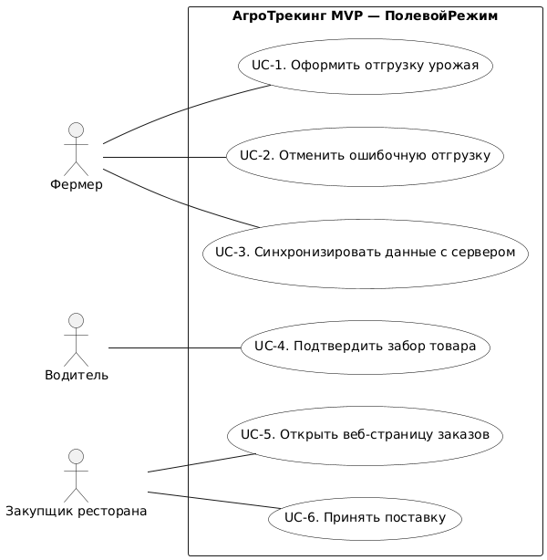
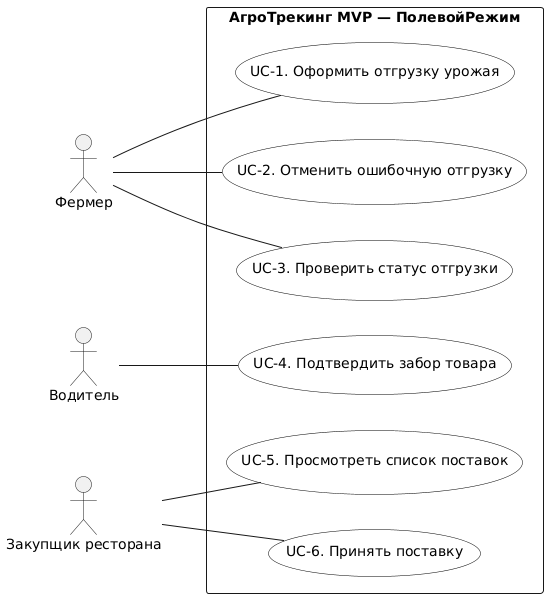

# Лабораторная работа 4: Моделирование вариантов использования (Use Case Diagram и основные сценарии)
## Кейс 2 «АгроТрекинг», вариация 2.2 «ПолевойРежим»

> Шаги 1–3 — первая версия артефактов (до AI-ревью). Шаг 4 — ревью и мои решения. **Итоговые артефакты после правок — в разделе «Шаг 5».**

---

## Шаг 1. Акторы и варианты использования (v1)

### 1.1. Акторы

| Актор (роль) | Цель при работе с системой | Основание |
|---|---|---|
| Фермер | Зафиксировать отгрузку урожая, исправить ошибочную отгрузку, убедиться, что отгрузка дошла до ресторана | Кейс §3; интервью (Лаб. 2); US-1, US-2 (Лаб. 3) |
| Водитель | Зафиксировать факт получения товара от фермера — граница, после которой отмена запрещена | Кейс §3; решение Лаб. 3 (статус «В пути») |
| Закупщик ресторана | Увидеть, какие поставки ожидаются, и принять доставленный товар | Кейс §3; Vision & Scope (Лаб. 1) |

### 1.2. Варианты использования (v1)

| № | Use Case | Основной актор | Покрываемое требование |
|---|---|---|---|
| UC-1 | Оформить отгрузку урожая | Фермер | БТ-1, БТ-2, БП-1, US-1 |
| UC-2 | Отменить ошибочную отгрузку | Фермер | БТ-4, БП-2, US-2 |
| UC-3 | Синхронизировать данные с сервером | Фермер | БТ-2, БТ-3 |
| UC-4 | Подтвердить забор товара | Водитель | Решение Лаб. 3 (граница БП-2) |
| UC-5 | Открыть веб-страницу заказов | Закупщик ресторана | Лаб. 1 (веб-страница ресторана) |
| UC-6 | Принять поставку | Закупщик ресторана | Лаб. 1 (цикл «отгрузка → доставка → приёмка») |

### 1.3. Допущения и границы модели

- Заказ заведён в системе до начала любого из сценариев; создание заказа в модель не входит (откуда берётся заказ — открытый вопрос кейса).
- Формирование ТТН-1 (кто подтверждает и на каком шаге) — открытый вопрос; роль «оператор ТТН-1» не вводится как актор, шаг в модель не входит.
- Платежи, маршрутизация, GPS-трекинг, личный кабинет с историей, мультиязычность, интеграция с ЕАИС — вне MVP (Out-of-Scope, Лаб. 1) и в модель не включаются.
- БТ-5 (без фоновых процессов, ≤200 МБ RAM) — нефункциональное ограничение, а не Use Case; учитывается в формулировках сценариев.
- Список заказов на устройстве фермера соответствует последней синхронизации; синхронизация происходит при открытии приложения в зоне сети (БП-1).

---

## Шаг 2. Use Case Diagram (v1)

Три актора-роли находятся вне границы системы; мобильное приложение фермера и веб-страница — одна система с одной границей. `include`/`extend` не используются: общих обязательных фрагментов между сценариями нет, и связи только усложнили бы модель. Каждая ассоциация — линия без стрелки. Для просмотра вставьте код на plantuml.com или в draw.io (Расположение → Вставить → Дополнительно → PlantUML). Рендер v1 — файл `lab4_diagram_v1.png`.

---

## Шаг 3. Спецификация Use Case «Отменить ошибочную отгрузку» (v1)

**Почему выбран этот Use Case:** он напрямую реализует жёсткое бизнес-правило БП-2 (отмена разрешена только до передачи товара водителю). В нём сходятся три «мины» кейса: offline-first и конфликт синхронизации, отсутствие приложения водителя, треснутый экран и страх фермера «нажать не туда». Это прямое продолжение US-2 и сценариев Лаб. 3.

**1. Название:** Отменить ошибочную отгрузку

**2. Основной актор:** Фермер

**3. Предусловия:**
1. Фермер вошёл в приложение.
2. По заказу оформлена отгрузка (статус заказа «Отгружен»).
3. Водитель ещё не забрал товар.

**4. Основной успешный сценарий (MSS):**
1. Фермер открывает список своих отгрузок и выбирает нужную.
2. Фермер инициирует отмену отгрузки.
3. Система запрашивает подтверждение отмены.
4. Фермер подтверждает отмену.
5. Система проверяет, что товар ещё не передан водителю.
6. Система возвращает заказ в статус «Ожидает отгрузки» и скрывает фото отгрузки из карточки заказа.
7. Система показывает фермеру результат отмены.

**5. Альтернативные потоки:**

**5а.** Забор товара уже зафиксирован.
5а.1. Система сообщает фермеру, что отменить нельзя.
5а.2. Сценарий завершается.

**4а.** Нет связи.
4а.1. Система сохраняет отмену на устройстве.
4а.2. При появлении связи система отправляет отмену на сервер.

**6. Постусловия:**
1. Заказ в статусе «Ожидает отгрузки».
2. Статус заказа обновлён.

---

## Шаг 4. AI-ревью модели и спецификации

### 4.1. Использованный промпт (дословно, с заполненными плейсхолдерами)

> «Ты — опытный системный аналитик, эксперт по UML и моделированию бизнес-процессов.
> Проанализируй предоставленные данные для проекта «АгроТрекинг», вариация 2.2 «ПолевойРежим»:
> 1. Список акторов и Use Cases.
> 2. Текстовую спецификацию выбранного Use Case.
>
> Твоя задача:
> 1. Проверь, не являются ли мои Use Cases скрытыми техническими функциями или шагами интерфейса. Если да, переформулируй их как цели пользователя.
> 2. Проверь спецификацию: есть ли в альтернативных потоках обработка критических сбоев, характерных для этого кейса (например, потеря связи, отказ в доступе, невалидные данные)? Если нет, предложи 1–2 конкретных альтернативных потока.
> 3. Укажи, если предусловия или постусловия сформулированы нечётко.
> Отвечай структурированно, без воды.
>
> Мои данные:
> Акторы: Фермер; Водитель; Закупщик ресторана.
> Use Cases: UC-1 Оформить отгрузку урожая (Фермер); UC-2 Отменить ошибочную отгрузку (Фермер); UC-3 Синхронизировать данные с сервером (Фермер); UC-4 Подтвердить забор товара (Водитель); UC-5 Открыть веб-страницу заказов (Закупщик ресторана); UC-6 Принять поставку (Закупщик ресторана).
> Спецификация UC-2 «Отменить ошибочную отгрузку». Основной актор: Фермер. Предусловия: 1) Фермер вошёл в приложение. 2) По заказу оформлена отгрузка (статус заказа «Отгружен»). 3) Водитель ещё не забрал товар. Основной сценарий: 1) Фермер открывает список своих отгрузок и выбирает нужную. 2) Фермер инициирует отмену отгрузки. 3) Система запрашивает подтверждение отмены. 4) Фермер подтверждает отмену. 5) Система проверяет, что товар ещё не передан водителю. 6) Система возвращает заказ в статус «Ожидает отгрузки» и скрывает фото отгрузки из карточки заказа. 7) Система показывает фермеру результат отмены. Альтернативные потоки: 5а) Забор товара уже зафиксирован: система сообщает фермеру, что отменить нельзя; сценарий завершается. 4а) Нет связи: система сохраняет отмену на устройстве; при появлении связи система отправляет отмену на сервер. Постусловия: 1) Заказ в статусе «Ожидает отгрузки». 2) Статус заказа обновлён.»

### 4.2. Ответ ИИ (кратко)

**1. Use Cases: технические функции и шаги интерфейса**
- UC-3 «Синхронизировать данные с сервером» — функция системы, а не цель фермера. Цель — узнать, дошла ли отгрузка. Переформулировать: «Проверить статус отгрузки».
- UC-5 «Открыть веб-страницу заказов» — шаг интерфейса. Цель закупщика — знать, какие поставки ожидаются. Переформулировать: «Просмотреть список поставок».
- Пробел покрытия: ни один UC не описывает появление заказа в системе. Добавить UC «Создать заказ на поставку» (Закупщик ресторана).
- UC-1, UC-2, UC-4, UC-6 — цели пользователя, уровень единый.

**2. Альтернативные потоки**
- **Конфликт при отложенной отмене.** Фермер подтвердил отмену без связи, а водитель до синхронизации уже зафиксировал забор. Нужны: условие, приоритет серверного статуса, реакция для фермера и исход для ресторана. Для offline-first это штатная ситуация.
- **Сбой или зависание приложения** после подтверждения отмены. Нужно гарантировать, что действие не теряется молча; после перезапуска приложение должно само повторить передачу.
- Поток 5а не называет причину и не фиксирует исход для заказа.

**3. Пред- и постусловия**
- Предусловие 3 — факт физического мира, а не проверяемое состояние системы; система не знает, что водитель «ещё не забрал» товар.
- Предусловия не различают отгрузку, уже переданную на сервер, и отгрузку, ожидающую передачи.
- Постусловие 2 «Статус заказа обновлён» — какой статус, где (приложение, сервер, веб-страница ресторана), к какому сроку?
- Нет постусловий для неуспешных и отложенных исходов (5а, 4а).
- «При появлении связи» (4а.2) подразумевает постоянный мониторинг сети, то есть фоновый процесс; вариация 2.2 запрещает работу в фоне. Момент передачи не определён.

### 4.3. Мои решения по замечаниям

| ИИ нашёл | Решение | Что изменено и где |
|---|---|---|
| UC-3 «Синхронизировать данные с сервером» — функция системы | Принято | Заменён на «Проверить статус отгрузки» (БТ-3, US-1). Синхронизация ушла внутрь UC-1 и UC-3 как шаг. См. 5.1, 5.2 |
| UC-5 «Открыть веб-страницу заказов» — шаг интерфейса | Принято | Заменён на «Просмотреть список поставок». См. 5.1, 5.2 |
| Нет потока «отмена офлайн, а водитель уже зафиксировал забор» | Принято | Добавлен поток **5а** в спецификацию: серверный статус «В пути» побеждает, отмена отклоняется, фермер получает объяснение. См. 5.3 |
| Нет обработки сбоя/зависания приложения | Принято частично | Добавлен поток **\*а**. Автоповтор после перезапуска не принят: по БП-1 и БТ-5 передача возможна только при следующем открытии приложения в зоне сети, без фона. См. 5.3 |
| Предусловия не различают отправленную и ожидающую отправки отгрузку | Принято | Добавлен поток **4а** (отмена отгрузки, не дошедшей до сервера). См. 5.3 |
| «При появлении связи» подразумевает фон; поток без момента передачи | Принято | Поток **4б** переписан: передача «при первом открытии приложения в зоне сети» (БП-1). Поток 5а v1 заменён потоком **2а** с причиной и исходом. См. 5.3 |
| Предусловие 3 — факт физического мира; постусловия размыты, нет неуспешных исходов | Принято | Предусловия сформулированы как состояния системы; постусловия разделены на успех, отложенный успех, локальный успех и отказ. См. 5.3 |
| Добавить UC «Создать заказ на поставку» | Отклонено | Создание заказа — открытый вопрос кейса и допущение п. 1.3: заказ заведён до начала сценариев. В MVP 2.2 (6 недель, 2 разработчика + аналитик) нет ресурса на отдельный контур заказов. Модель не меняется |

---

## Шаг 5. Итоговые артефакты после правок

### 5.1. Итоговые акторы и Use Cases

Акторы без изменений: **Фермер**, **Водитель**, **Закупщик ресторана**.

| № | Use Case | Основной актор | Трассировка |
|---|---|---|---|
| UC-1 | Оформить отгрузку урожая | Фермер | БТ-1, БТ-2, БП-1, US-1 |
| UC-2 | Отменить ошибочную отгрузку | Фермер | БТ-4, БП-2, US-2 |
| UC-3 | Проверить статус отгрузки | Фермер | БТ-3, US-1 (часть «видеть, дошла ли») |
| UC-4 | Подтвердить забор товара | Водитель | Решение Лаб. 3 (граница БП-2) |
| UC-5 | Просмотреть список поставок | Закупщик ресторана | Лаб. 1 (веб-страница ресторана) |
| UC-6 | Принять поставку | Закупщик ресторана | Лаб. 1 (цикл «…→ приёмка») |

БТ-5 учтено как нефункциональное ограничение (в сценариях нет фоновых процессов и push/SMS).

**Что изменилось относительно v1:** UC-3 «Синхронизировать данные с сервером» (функция системы) заменён целью «Проверить статус отгрузки»; UC-5 «Открыть веб-страницу заказов» (шаг интерфейса) заменён целью «Просмотреть список поставок».

### 5.2. Итоговая диаграмма

Рендер: `lab4_diagram_final.png` / `lab4_diagram_final.svg`.

### 5.3. Итоговая спецификация Use Case «Отменить ошибочную отгрузку»

**1. Название:** Отменить ошибочную отгрузку

**2. Основной актор:** Фермер

**3. Предусловия:**
1. Фермер идентифицирован в приложении.
2. В приложении по заказу есть оформленная отгрузка: в последних известных приложению данных заказ имеет статус «Отгружен».
3. В последних известных приложению данных по заказу нет статуса «В пути».

**4. Основной успешный сценарий (MSS):**
1. Фермер выбирает отгрузку и инициирует её отмену.
2. Система проверяет по последним известным данным, что статус «В пути» отсутствует, и запрашивает явное подтверждение отмены с указанием товара и ресторана.
3. Фермер подтверждает отмену.
4. Система, обнаружив связь, передаёт отмену на сервер.
5. Сервер сверяет актуальный статус заказа: «В пути» отсутствует, отмена принимается, заказ получает статус «Ожидает отгрузки».
6. Система отражает статус «Ожидает отгрузки» в приложении, помечает запись статусом отправки «отправлено» и скрывает фото отгрузки из карточки заказа.
7. Система сообщает фермеру, что отгрузка отменена.

**5. Альтернативные потоки:**

**2а. В последних известных данных у заказа есть статус «В пути»** *(граница БП-2)*
2а.1. Система не предлагает отмену и сообщает фермеру, что товар уже забран водителем и поэтому отмена невозможна.
2а.2. Статус заказа не меняется. Сценарий завершается с постусловием «отказ».

**3а. Подтверждение отмены не получено** *(защита от случайного нажатия на повреждённом экране)*
3а.1. Запрос подтверждения закрыт без согласия фермера.
3а.2. Система ничего не передаёт и ничего не меняет: отгрузка остаётся в статусе «Отгружен». Сценарий завершается без изменений (возврат на шаг 1 по инициативе фермера).

**4а. Отгрузка ещё не передана на сервер (статус отправки «ожидает отправки»)** *(мина: offline-first)*
4а.1. После шага 3 система исключает запись об отгрузке из очереди передачи и возвращает заказ в приложении в статус «Ожидает отгрузки».
4а.2. Передача на сервер не выполняется: ресторан отгрузку не видел и не увидит. Фото отгрузки скрывается из карточки заказа.
4а.3. Система сообщает фермеру, что отгрузка отменена, не успев уйти на сервер. Сценарий завершается с постусловием «локальный успех».

**4б. Нет связи, отгрузка ранее передана на сервер** *(мина: потеря связи)*
4б.1. Система сохраняет подтверждённую отмену на устройстве, присваивает записи статус отправки «ожидает отправки» и сообщает фермеру, что отмена принята, но ресторану ещё не передана.
4б.2. Передача отмены выполняется при первом открытии приложения в зоне сети — без фоновых процессов и без повторного подтверждения (БП-1).
4б.3. Если за это время водитель не зафиксировал забор — возврат на шаг 5. Если зафиксировал — переход к потоку 5а. До синхронизации серверный статус остаётся «Отгружен». Исход до передачи — «отложенный успех».

**5а. Сервер уже имеет статус «В пути» (конфликт синхронизации)** *(мина: водитель зафиксировал забор до передачи отмены)*
5а.1. Сервер отклоняет отмену: серверный статус «В пути» имеет приоритет над локальным решением фермера.
5а.2. Система аннулирует локальную отмену, отражает в приложении статус «В пути» и сообщает фермеру простым языком, что отмена не принята, потому что водитель уже забрал товар.
5а.3. Ресторан продолжает видеть статус «В пути». Сценарий завершается с постусловием «отказ».

**\*а. Сбой или зависание приложения в ходе сценария** *(мина: один необработанный сбой — отказ фермера от приложения)*
\*а.1. Если сбой произошёл до подтверждения (шаги 1–3): ничего не изменено; при следующем открытии приложение показывает прежний статус отгрузки.
\*а.2. Если сбой произошёл после подтверждения: намерение отмены сохраняется на устройстве до начала передачи; при следующем открытии приложения в зоне сети система возобновляет сценарий с шага 4 без повторного подтверждения. Фермер видит актуальный статус отправки записи.
\*а.3. Если подтверждение не успело сохраниться: отмена не считается выполненной, приложение показывает неизменённый статус «Отгружен» — отмена не теряется молча и не выглядит выполненной. Фермер может повторить сценарий с шага 1.

**6. Постусловия:**
- **Успех (основной сценарий):** заказ в статусе «Ожидает отгрузки» на сервере и в приложении; статус отправки записи — «отправлено»; фото отгрузки скрыто из карточки заказа; на веб-странице ресторана статус «Ожидает отгрузки» отображается не позднее 60 секунд после синхронизации.
- **Отложенный успех (4б):** в приложении по заказу зафиксирована отмена со статусом отправки «ожидает отправки»; серверный статус остаётся «Отгружен» до синхронизации; ресторан видит прежний статус; фермеру показано, что отмена ещё не передана.
- **Локальный успех (4а):** заказ в приложении в статусе «Ожидает отгрузки»; на сервере отгрузки по заказу нет; в очереди передачи нет записи об этой отгрузке; ресторан отгрузку не видел.
- **Отказ (2а, 5а):** статус заказа «В пути» на сервере и в приложении; отмена не выполнена; фермер проинформирован о причине; повторно отмена не предлагается; ресторан видит «В пути».
- **Без изменений (3а, \*а.1, \*а.3):** статус заказа и статус отправки записи остались прежними; данные фермера не потеряны.

---

## Работа с ИИ

**Пара 1 (пробел в альтернативных потоках).** ИИ указал на отсутствие обработки сценария «отмена оформлена офлайн, а водитель к моменту передачи уже зафиксировал забор». Я добавил его в альтернативный поток 5а моей спецификации: серверный статус «В пути» имеет приоритет, отмена отклоняется, фермер получает понятное объяснение, ресторан продолжает видеть «В пути». Для offline-first MVP без приложения водителя это штатная ситуация, а не экзотика.

**Пара 2 (пробел в альтернативных потоках).** ИИ указал на отсутствие обработки сценария «сбой или зависание приложения после подтверждения отмены». Я добавил его в альтернативный поток \*а моей спецификации: намерение отмены сохраняется до передачи, после перезапуска сценарий возобновляется без повторного подтверждения, а если сохранить не успели — приложение честно показывает неизменённый статус. Автоповтор «сам после перезапуска» я не принял: по БП-1 и БТ-5 передача возможна только при следующем открытии приложения в зоне сети, без фона.

**Пара 3 (пробел в альтернативных потоках).** ИИ указал на то, что предусловия не различают отгрузку, переданную на сервер, и отгрузку со статусом отправки «ожидает отправки», — то есть не обработан сценарий отмены ещё не отправленной отгрузки. Я добавил его в альтернативный поток 4а моей спецификации: запись исключается из очереди, на сервер ничего не уходит, ресторан отгрузку не видит.

**Пара 4 (формулировки).** ИИ указал на то, что UC-3 «Синхронизировать данные с сервером» — функция системы, а UC-5 «Открыть веб-страницу заказов» — шаг интерфейса. Я переформулировал их как цели: «Проверить статус отгрузки» и «Просмотреть список поставок». Также по замечанию о «при появлении связи» (фон запрещён вариацией 2.2) я переписал поток 4б: передача выполняется при первом открытии приложения в зоне сети.

**Пара 5 (формулировки: пред- и постусловия).** ИИ указал на то, что предусловие «Водитель ещё не забрал товар» — факт физического мира, а постусловие «Статус заказа обновлён» не называет статус, место и срок. Я заменил предусловие проверяемым состоянием системы («в последних известных приложению данных нет статуса «В пути»») и переписал постусловия: успех, отложенный успех, локальный успех, отказ и «без изменений» — с указанием статусов, места и срока (60 секунд после синхронизации).

**Пара 6 (отклонённая рекомендация).** ИИ предложил добавить Use Case «Создать заказ на поставку», но это некорректно в контексте вариации 2.2: создание заказа — открытый вопрос кейса, в MVP за 6 недель командой из 2 разработчиков и аналитика на него нет ресурса, а в допущениях п. 1.3 зафиксировано, что заказ заведён до начала сценариев. Я оставил модель без изменений.
